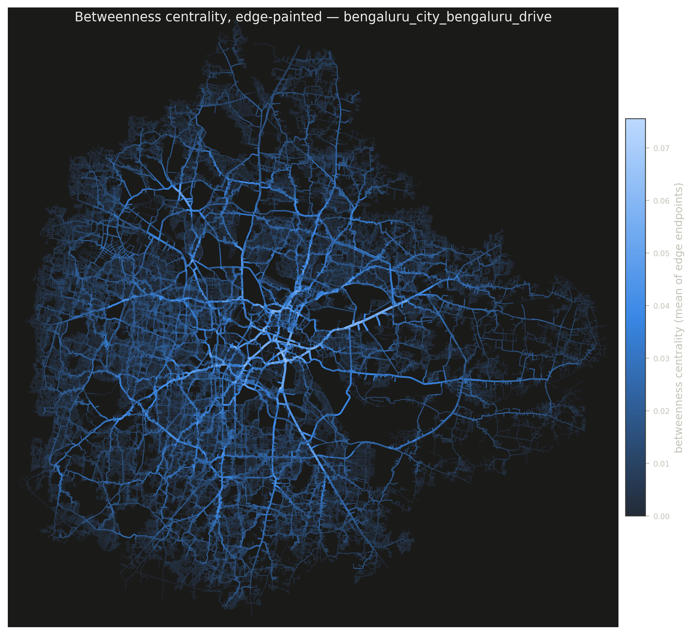
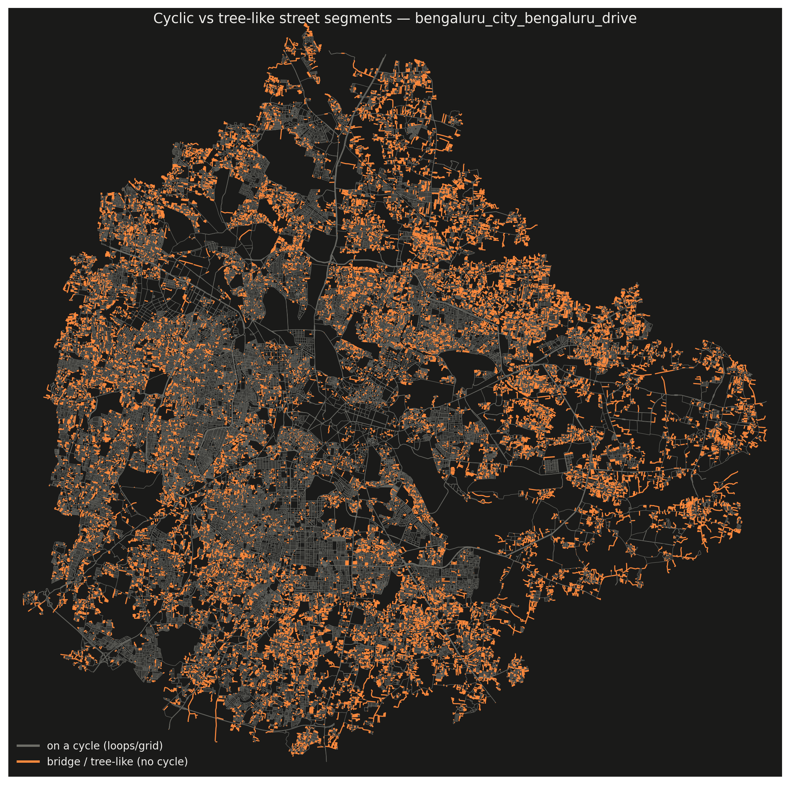
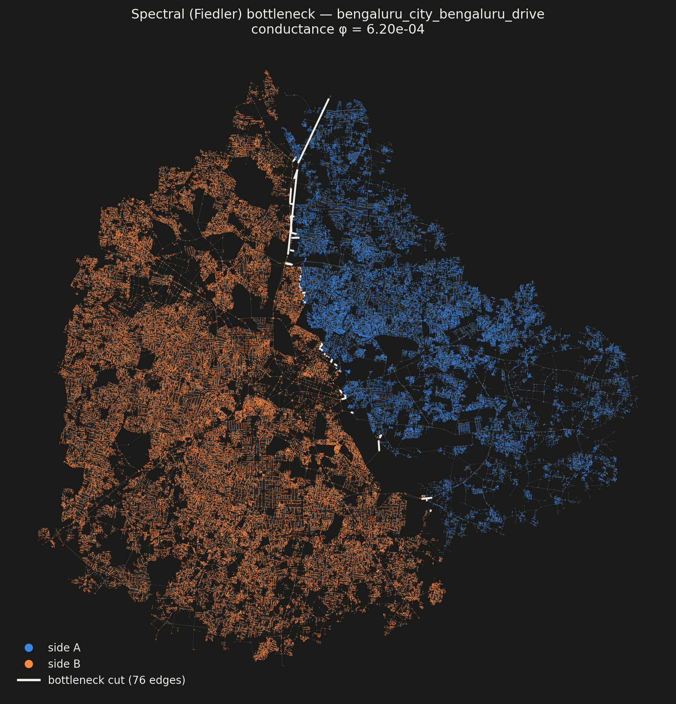
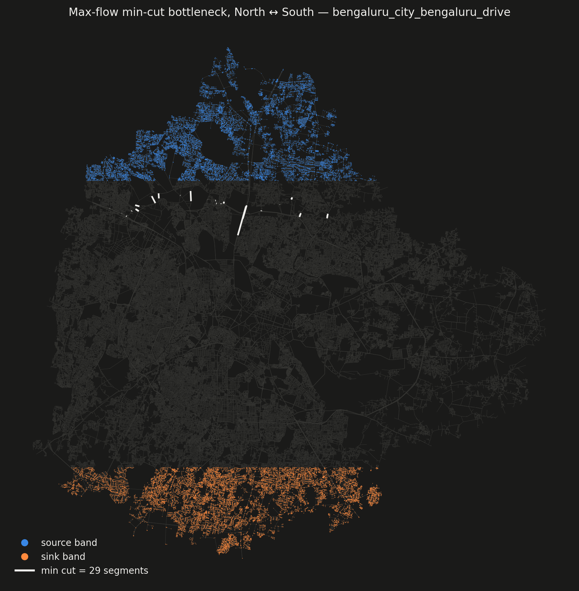
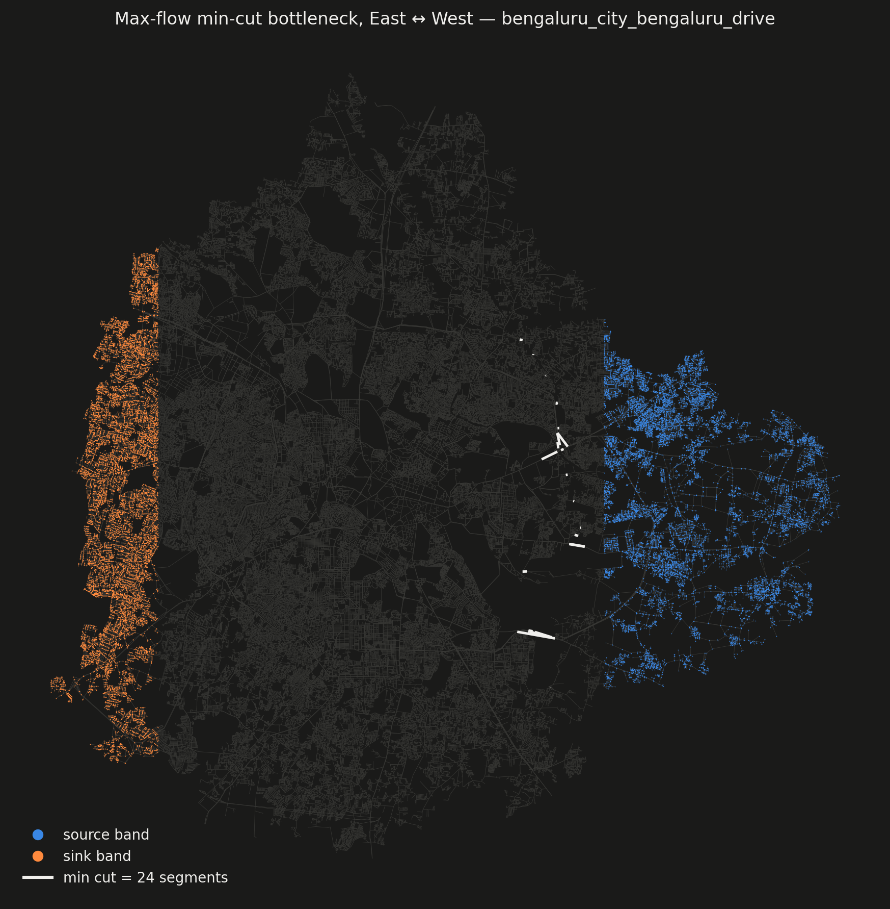
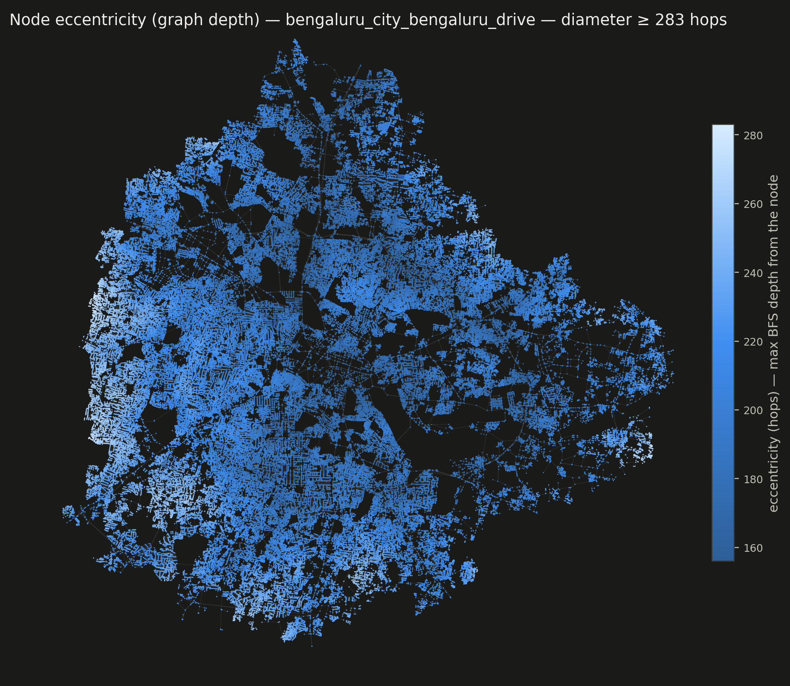
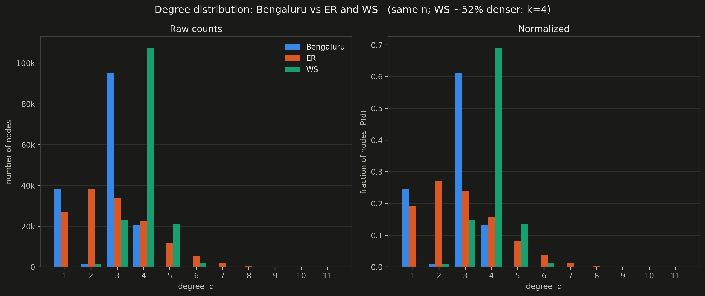
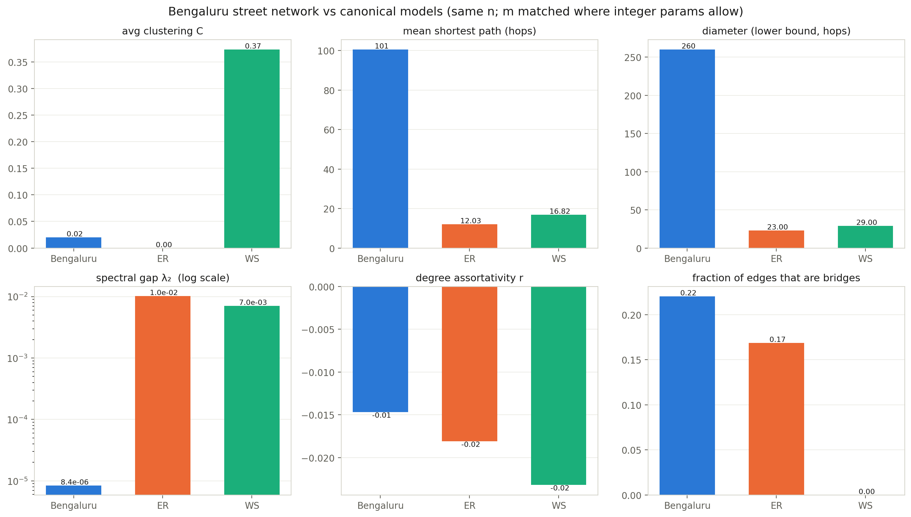
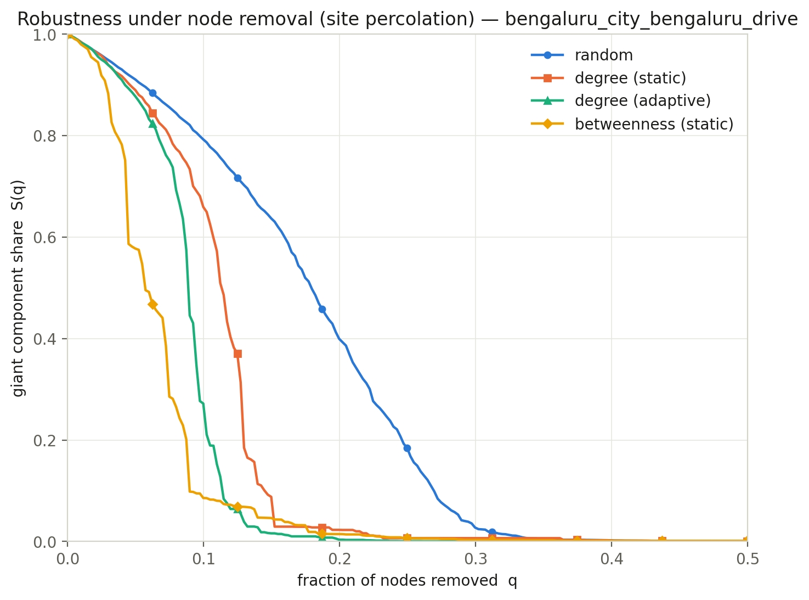
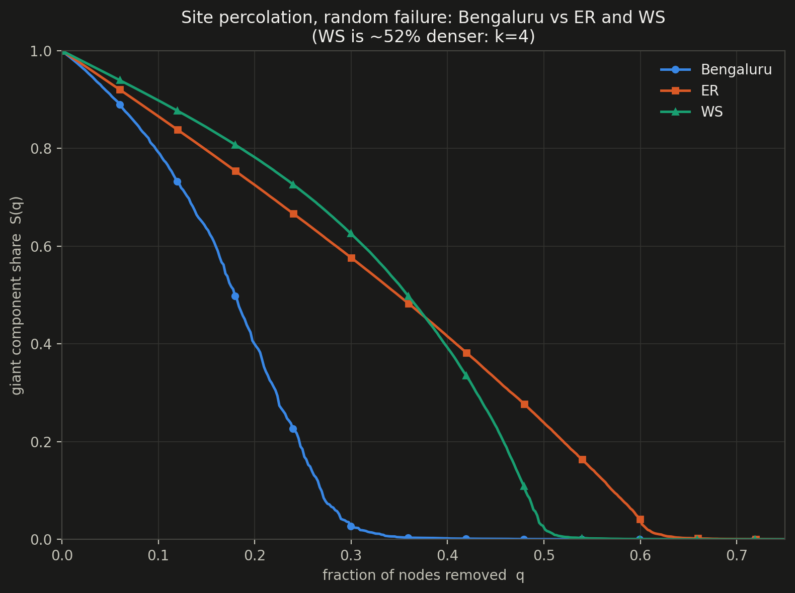

# Bengaluru Road Network — Analysis Results

*ID5080 Complex Networks term project — Bengaluru side (Chennai handled separately).*
*Network: OpenStreetMap drivable streets within the BBMP boundary, fetched 2026-10-05 via osmnx (`fetch_namma.py bengaluru city`). All analyses run from `data/bengaluru_city_bengaluru_drive.graphml`; scripts listed at the end.*

---

## 1. The network at a glance

| Quantity | Value |
|---|---|
| Nodes (intersections / dead ends) | 155,779 |
| Edges (street segments, undirected) | 205,640 (205,064 simple) |
| Total street length | 13,001 km |
| Connected components | 1 |
| Mean degree | 2.63 (max **6** — physical limit of a road junction) |
| Mean shortest path | 100.6 hops |
| **Diameter (exact)** | **283 hops** |
| Degree assortativity | −0.015 (≈ neutral) |
| Avg clustering coefficient | 0.020 |
| Spectral gap λ₂ (normalized Laplacian) | 8.44 × 10⁻⁶ |

---

## 2. Betweenness centrality

Length-weighted, 300-source approximation on the largest SCC (155,416 nodes); values cached in `results/bengaluru_city_bengaluru_drive_node_bc.npz`.

- Load is highly concentrated: **the top 1% of intersections carry 20.1% of total betweenness** (mean 0.0014, max 0.078).
- The heaviest intersections trace the old core's arterial spine:

| # | bc | Intersection |
|---|---|---|
| 1–2 | 0.078 / 0.073 | Brigade Road / Hosur Road / Richmond Road |
| 3 | 0.062 | Dr. B R Ambedkar Veedhi / Raj Bhavan Road |
| 4 | 0.062 | Cockburn Road / Netaji Road |
| 5 | 0.060 | Brigade Road / Residency Road |

Full top-20 with coordinates: `results/bengaluru_city_bengaluru_drive_top_betweenness.csv`.

## 3. Cyclic structure

- Cyclomatic number **μ = 49,862** independent cycles; α = 0.160, β = 1.320, γ = 0.440. An organic-growth profile — a pure grid would push α towards ~0.25–0.3.
- **79.2% of road length lies on cycles**; 21.9% of segments (2,708 km) are **bridges** — dead-end/tree-like streets, concentrated in the newer periphery.
- The 2-core (dead-end trees stripped) keeps 71.5% of nodes; one giant biconnected block spans 69.5% of the city.

## 4. Expansion, Ramanujan test, bottlenecks

- λ₂ = 8.44 × 10⁻⁶; Cheeger bounds 4.2 × 10⁻⁶ ≤ h(G) ≤ 4.1 × 10⁻³, with a certified sweep cut of conductance **φ = 6.2 × 10⁻⁴**.
- Ramanujan test at d̄ = 2.63: μ₂ = 0.999992 > bound 0.9707. λ₂ falls **~3,500× short** of what an expander of this degree needs. Random-walk mixing time ~1/λ₂ ≈ 118,000 steps. **Verdict: decisively not an expander, not Ramanujan** — the expected behaviour of a near-planar graph with O(√n) separators (√n ≈ 395).
- The bottlenecks are physical and few:
  - **Fiedler cut**: 76 road segments split the city into two balanced halves (~49k vs ~106k nodes) along a north–south seam.
  - **Max-flow/min-cut (Menger)**: **29 segments** disconnect the northern 10% band from the southern; **24 segments** separate east from west.

## 5. Depth (eccentricity) and diameter

- Eccentricity computed for every node via 64 farthest-point landmark BFS sweeps; the landmark bound matched the exact diameter (extrema-bounding verification, 25 min).
- **Diameter = 283 hops (exact)**; eccentricity ranges 156 (graph center) → 283, median 204.
- Mean shortest path ≈ 100.6 hops ≈ 0.25·√n — the √n scaling of a 2-D lattice, *not* the log n of a small world.

## 6. Comparison with ER and WS models (same n = 155,779)

| Metric | **Bengaluru** | ER G(n,m) | WS (k=4, p=0.1) |
|---|---|---|---|
| Edges m | 205,064 | 205,064 (GCC 203,352) | 311,558 († k must be even integer) |
| Giant component | 100% | 90.9% | 100% |
| Max degree | **6** | 11 | 8 |
| Clustering C | 0.020 | ~0 | 0.374 |
| Mean path (hops) | **100.6** | 12.0 | 16.8 |
| Diameter | **283** | ≥23 | ≥29 |
| λ₂ | **8.4 × 10⁻⁶** | 1.0 × 10⁻² | 7.0 × 10⁻³ |
| Assortativity | −0.015 | −0.018 | −0.023 |
| Bridge fraction | 0.220 | 0.169 | 0.000 |

Reading: Bengaluru has ER-like (near-zero) clustering but paths ~8× longer than ER and a spectral gap ~1,000× smaller — the opposite of the small-world property WS adds. The street network is a **spatially constrained, near-planar lattice**, not captured by either model (nor by degree-heterogeneous models — see §7).

Degree make-up: Bengaluru is 61% degree-3 (T-junctions) and 25% degree-1 (dead ends), with almost no degree-2 nodes (interstitial points are merged by osmnx simplification) and nothing above 6. ER spreads Poisson-style over 1–11; WS concentrates on its ring degree 4.

## 7. Degree exponent γ vs the AB model

AB (Barabási–Albert) predicts a scale-free tail with γ = 3. Bengaluru's junction degrees span only **1–6** (you cannot build a 50-way intersection), so a discrete power-law MLE is wildly unstable: γ̂ = 1.64 (d_min = 1), 2.35 (d_min = 2), 5.27 (d_min = 3). **Conclusion: the degree distribution is narrow/exponentially bounded — not scale-free; preferential attachment is the wrong growth mechanism for roads.**

## 8. Robustness (site percolation)

Giant-component share S(q) vs fraction of nodes removed q, exact for every q via a reverse Newman–Ziff union–find sweep. Strategies: random failure (5-seed average), degree-targeted (static and adaptive), betweenness-targeted (static, cached approx values).

Collapse thresholds q_c (first q where the giant component drops below 1% of n):

| Strategy | q_c |
|---|---|
| Random failure (5-seed avg) | **0.331** |
| Degree-targeted (static) | 0.231 |
| Betweenness-targeted (static) | 0.226 |
| Degree-targeted (adaptive) | **0.183** |

Reading: with no hubs to exploit (max degree 6), targeted attacks gain less here than in scale-free networks — the attack/failure ratio is ~1.8×, not the orders-of-magnitude seen in AB-type graphs. The betweenness attack is the most damaging early on: removing just ~6% of intersections (the high-betweenness arterial junctions) already halves the connected city. But in absolute terms the network is fragile under *any* removal: losing a random third of intersections already shatters it (an ER graph of the same mean degree holds out until q ≈ 0.62), another consequence of the sparse lattice structure.

**Versus ER and WS** (same n; ER same m; WS ~52% denser at k = 4):

| Graph | random q_c | adaptive-degree q_c |
|---|---|---|
| **Bengaluru** | **0.331** | 0.183 |
| ER | 0.622 | 0.172 |
| WS | 0.510 | 0.278 |

Under *random failure* Bengaluru is by far the most fragile — it collapses at half the removal fraction ER survives, because its sparse lattice structure has no long-range shortcuts to reroute through. Under a *targeted attack* the three graphs converge (q_c 0.17–0.28): with no hubs anywhere, an attacker gains little extra leverage over the models — but note Bengaluru loses most of its connectivity far earlier in the attack (S(q) is near zero by q ≈ 0.12).

## 9. Road-network growth over time — dataset options

Goal: data to fit a growth model for Bengaluru's road network.

1. **OSM history via ohsome (HeiGIT Heidelberg)** — recommended first step, no bulk download. The [ohsome dashboard](https://heigit.org/?p=1650) computes road-length-over-time for a chosen boundary server-side; the [ohsome API](https://wiki.openstreetmap.org/wiki/Ohsome_API) does the same via REST, and its [extraction endpoints](https://giscienceblog.uni-heidelberg.de/?p=18001) return full road-geometry snapshots at chosen timestamps (yearly Bengaluru graphs). **Caveat: OSM history records *mapping*, not construction** — Bengaluru was traced into OSM mostly 2008–2015, so the series is only meaningful as real growth after ~2015.
2. **Digitized historical maps** — [BLR Yesterday](https://homegrown.co.in/homegrown-creators/blr-yesterday-lets-you-travel-through-bengalurus-past-one-virtual-map-at-a-time) hosts georeferenced historical Bengaluru maps; the [CHRONEX-US methodology](https://arxiv.org/pdf/2506.16625) (dating road segments from historical topo maps) is replicable on Survey of India toposheets. No published Bengaluru road-growth dataset exists — making one would itself be a contribution.
3. **Growth covariate** — the IISc CES Landsat series ([Ramachandra et al.](https://wgbis.ces.iisc.ac.in/energy/paper/geoinformatics); [+125% built-up 2000–2014](https://gisresources.com/study-reveal-125-increase-in-bengaluru-urban-growth/)) quantifies urban expansion 1973→present; roads track built-up area.
4. **Full-history OSM extract** (campus Wi-Fi job, ~hundreds of MB): Geofabrik internal history PBF + `osmium time-filter` → yearly osmnx graphs.

Modeling framework suggestion: Strano et al. (2012) / Barthélemy–Flammini **densification vs exploration** road-growth models — fit against yearly ohsome snapshots post-2015.

## 10. Reproducibility

- Env: `python3 -m venv .venv && .venv/bin/pip install -r requirements.txt` (osmnx 2.0.7, networkx 3.4.2, scipy, matplotlib).
- Scripts (run with `.venv/bin/python <script> data/bengaluru_city_bengaluru_drive.graphml`):
  - `fetch_namma.py bengaluru city` — data download (cached in `cache/`)
  - `analyze_bengaluru.py` — betweenness + cyclic structure (+ light-theme maps)
  - `betweenness_edges.py` — edge-painted betweenness map (uses cached bc)
  - `expander_bottleneck.py` — λ₂/Cheeger/Ramanujan, Fiedler cut, min cuts (dark maps)
  - `model_comparison.py` — ER/WS comparison table + charts
  - `depth_diameter.py` — eccentricity, diameter, γ check
  - `percolation.py` — robustness curves
  - `render_dark_maps.py` — dark-theme re-render of betweenness/cycles/eccentricity maps
- Raw numbers: `results/*.txt`, `results/model_comparison.csv`; cached arrays: `results/*.npz`.
